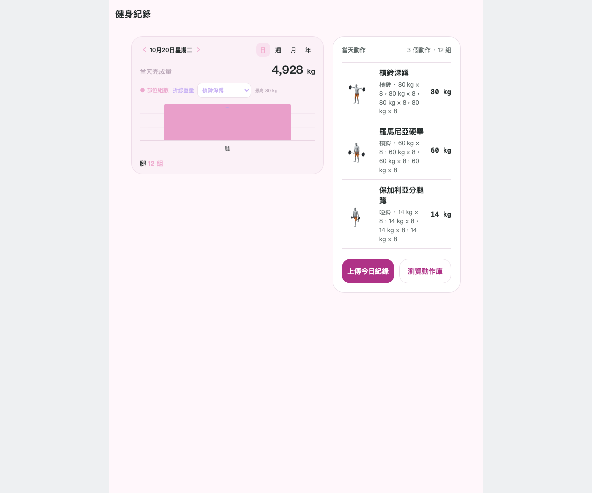

# Fitness Journal

獨立健身紀錄器：動態 3D 動作示範、當天動作、課表、組數與重量、訓練統計、JSON / CSV 備份。

**[Open the live app](https://clark970417-eng.github.io/fitness-journal/)** · [Source](https://github.com/clark970417-eng/fitness-journal)



## Run locally

Node.js 22 or newer:

```sh
npm ci
npm run build
npm start
```

Open the URL printed by the server (default `http://127.0.0.1:8080`). Do not open `index.html` through `file://`.

```sh
npm test
npx playwright install chromium
npm run test:browser
```

Browser tests launch their own temporary local server; set `TEST_PORT` if port 8195 is occupied. They use fresh browser contexts and synthetic records/files. A browser viewport emulates iPhone dimensions and touch; this does not certify physical iPhone hardware, background execution or lock-screen behavior.

## Features and data

Training data and optional imported video clips stay in this browser (IndexedDB/localStorage). No account, cloud service or API key is required. Export backups before clearing site data. Prescription weights are editable examples, not previously completed workouts; the dashboard begins with zero history. Local video replay and manual set review are included; Pocket-only Gemini video analysis is intentionally excluded from this standalone edition. 3D demos require WebGL; they illustrate movement and are not individualized exercise advice.

## Verification

9 core tests cover history/statistics, set replacement, storage, editable daily actions, exercise-library insertion and weight defaults. Browser tests cover onboarding, animated-model loading, daily edits, chest-supported row search, saving a workout, dashboard totals and reload persistence on desktop and iPhone-sized viewports.

See [mobile preview](screenshots/mobile.png). The GitHub Actions workflow tests and builds every `main` push, then deploys `dist/` to GitHub Pages. Relative assets support repository subpaths. These four repositories are independent; no Pocket installation is needed.

## Provenance and licenses

Extracted and adapted from the Cyrene Pocket / Cyrene-Agent workspace. The original Cyrene-Agent project is by [Playa-0v0](https://github.com/Playa-0v0/Cyrene-Agent); its MIT notice is retained in [LICENSE](LICENSE). Standalone packaging and integration by Clark. No personal records, credentials, private photos, or character artwork are included.

The human model is Microsoft Rocketbox Sports_Male_01 (MIT); see [MODEL-LICENSE.md](MODEL-LICENSE.md). Three.js is MIT ([notice](THREE-LICENSE)); icons derive from Ant Design Icons (MIT, [notice](ICONS-LICENSE)). Movement/equipment code is included with a reproducible local bundle build. The venue equipment reference is public metadata in `zhubei-equipment.json`; that list is not proof that every unit remains available.
